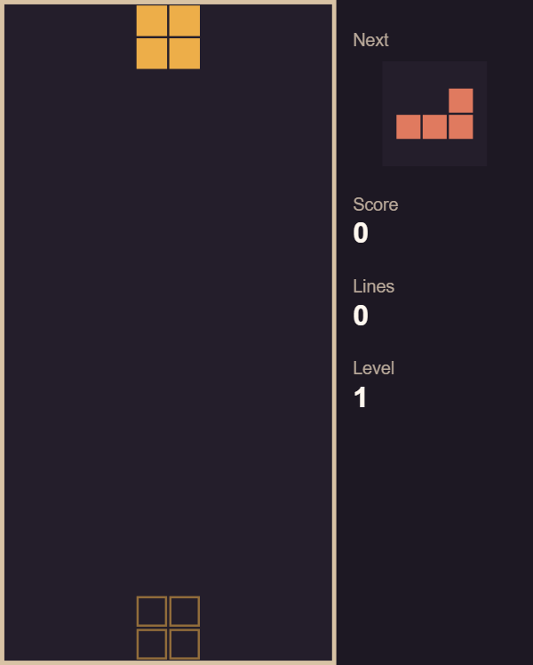
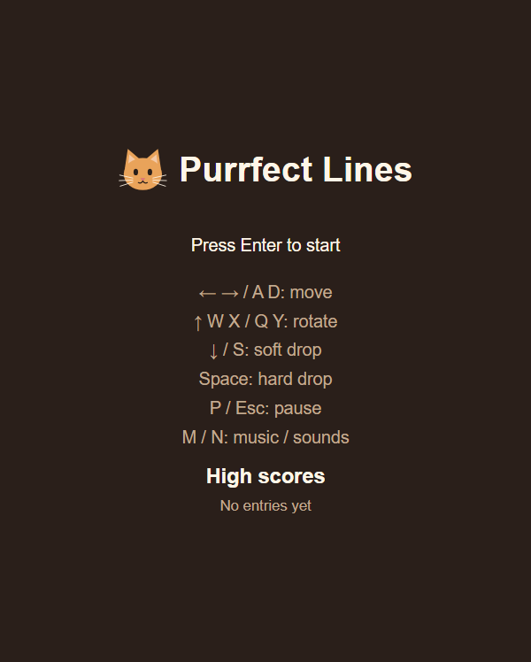
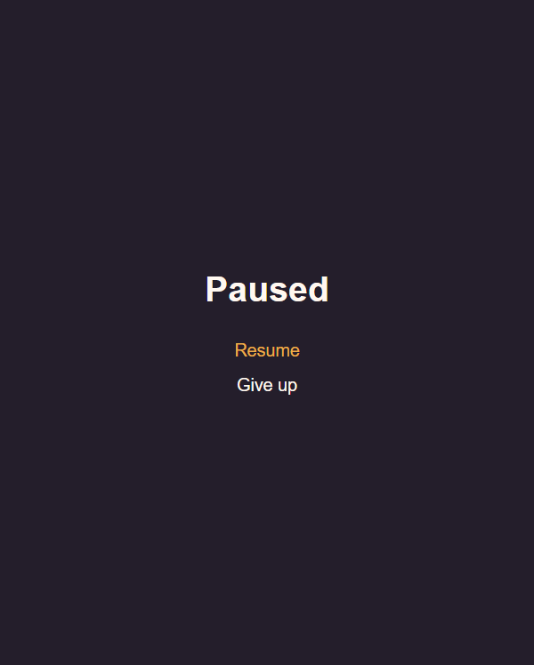
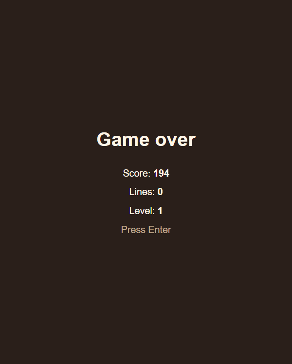

# Purrfect Lines

[](https://github.com/SaijSaij/purrfect-lines/actions/workflows/ci.yml)

A cosy falling-block puzzle for the browser, with a cat's touch.

**[Play it online](https://saijsaij.github.io/purrfect-lines/)**: nothing to
install, you only need a physical keyboard.



[Play](#play) · [High scores](#high-scores) · [Sound](#sound) · [Language](#language) · [Controls](#controls) · [Scoring and levels](#scoring-and-levels) · [License](#license) · [Development](docs/DEVELOPMENT.md)

## What it is

Pieces made of four blocks fall into a field of 10 × 20 cells. Move and rotate
them so they complete rows: full rows light up and disappear. The game gets
faster as you clear rows, and it ends when the stack reaches the top.

The look is warm and its own: dark browns and cream, seven pieces in
terracotta, raspberry, mustard, teal, olive, plum and light sage, a small paw
print on every block and a cat head next to the title. Everything is drawn by
the game itself; there are no image files.

The game has start, pause and game over screens, a high score list, sounds
and music, and speaks English and German. A thin line under the game area
names the game, links to its source code and names its license.

**You need a physical keyboard.** The game has no touch controls. On a phone
or tablet without a mouse, the start screen says so instead of "Press Enter
to start"; with a keyboard attached, Enter still starts the game.

| Start | Pause | Game over |
|---|---|---|
|  |  |  |

## Play

Open https://saijsaij.github.io/purrfect-lines/ in a current desktop browser
based on Chromium or Firefox. The online version is normally the latest
checked state of the main branch.

The start screen shows the title, the keys and the
high score list; press Enter to start. A piece falls from the top centre by
about one row per second, and a thin outline in the piece's color (the ghost piece) shows where it
will land. The sidebar shows the next piece, the score, the cleared rows
(lines) and the level. When the stack reaches the top, the game over screen
shows your score, lines and level. Press Enter: if the score makes it into the
high score list, you enter your name next, otherwise you are back on the start
screen.

### Play locally

To run the game on your own computer instead,
you need Windows (the setup is only tested there), Git, Node.js 26 LTS
(`winget install OpenJS.NodeJS.LTS`, then check in a new terminal with
`node --version`), a keyboard and a current desktop browser based on Chromium
or Firefox. Clone the repository and change into its folder:

```bash
git clone https://github.com/SaijSaij/purrfect-lines.git
```

```bash
cd purrfect-lines
```

Install once:

```bash
npm ci
```

Then start the game:

```bash
npm run serve
```

The server keeps running in the terminal until you stop it with Ctrl+C. If
port 5173 is already taken, it stops with an error; free the port first.

Open http://localhost:5173.

To play the release version instead, build it and serve it, then open
http://localhost:4173:

```bash
npm run build
```

```bash
npm run preview
```

## High scores

The list keeps the 10 best games with name, score, lines, level and date. A
game enters it if it scored more than 0 points and the list has fewer than 10
entries or the score beats the last one; on equal scores the older entry stays
ahead.

- **Name entry:** type up to 12 characters; all keys, including Space and the
  game keys, are just text here. Enter saves and shows the list with your new
  entry highlighted, and Enter again leads to the start screen. Esc skips the
  entry, saves nothing and leads to the start screen. Spaces at the start and
  end are removed (spaces at the start count towards the 12 characters), and
  an empty name is saved as "Kitty" (in German: "Katze"); entries saved
  earlier keep their name when you switch the language. Next time the field
  holds what you typed last (empty if you left it empty).
- **Saving:** the list, your last name, the sound settings and the language
  you chose with L are stored in
  the browser (localStorage) and survive a reload. Each address keeps its own
  list: the online version, http://localhost:5173 and the release version on
  port 4173 do not share it. If the browser does not allow
  saving (for example when site data is blocked), the game still runs, the
  list and the settings last only until the page is reloaded, and the
  start screen says so.
  Invalid stored entries are dropped; if nothing can be read, the list starts
  empty.

The game area fills the browser window as far as its fixed shape allows. It
adapts at once when you resize the window and stays sharp on scaled displays
(e.g. 125 % or 150 %).

## Sound

The game has its own sounds for rotating, locking, a hard drop, cleared rows
(four at once sound like a cat), a new level, the end of a game and choosing
in menus. Moving is silent. While you play, a music loop of about 30 seconds
runs; it gets 3 % faster with every level, at most 40 % faster (from level 15
on). The music is silent on all other screens and in the pause, and after a
pause it continues where it stopped. Everything is made by the browser while
the game runs; there are no audio files.

- **M** switches the music, **N** the sounds on and off, on every screen
  except the name entry. The bottom of the sidebar shows both, and the setting
  is saved like the high score list. Both are on at the first start.
- The music only runs during a game, so the start screen is silent. Browsers
  allow sound only after a key press; your first key press switches it on.
- If you hear nothing, check that neither the browser tab nor the system is
  muted. If the browser cannot play sound at all, the game stays silent and
  runs as usual.

## Language

The game speaks English and German. On the first start it uses German if
your browser's preferred language is German (any language code starting with `de`,
e.g. `de-DE` or `de-AT`), otherwise English.

- **L** on the start screen switches between English and German; the line
  "L: Deutsch" or "L: English" there names the other language. The choice is
  saved like the high score list and wins over the browser language from then
  on. Until you press L, the game follows the browser language.
- Dates in the high score list follow the language: German as DD.MM.YYYY,
  English as M/D/YYYY (1 February 2026 is 01.02.2026 or 2/1/2026).

## Controls

| Key | Action |
|---|---|
| ← / → or A / D | Move left / right |
| ↓ or S (hold) | Soft drop: fall 20 times faster |
| ↑, W or X | Rotate clockwise |
| Q or Y | Rotate counter-clockwise |
| Space | Hard drop: fall to the bottom and lock at once |
| P or Esc | Pause / continue |
| ↑ / ↓ or W / S | Choose in the pause menu |
| Enter | Start screen: start a game. Pause menu: confirm. Game over: on to the name entry or the start screen. Name entry: save. High score list: back to the start screen |
| Esc | Name entry: skip without saving |
| M / N | Music / sounds on and off (not in the name entry) |
| L | Start screen: switch between English and German |

Letters work in upper and lower case and are recognised by the character they
type, so Y is the key labelled Y on any Latin keyboard layout (on a German
keyboard it sits where Z is on an English one).

- **Pause:** the field is hidden and time stands still. The menu offers
  "Resume" and "Give up"; giving up ends the game like a regular game over.
  Continuing picks up exactly where the game stopped. When the window loses
  focus or the tab is hidden, a running game pauses by itself and stays
  paused when you come back.
- **Holding a move key** moves the piece once, then after a short pause it
  keeps sliding until you let go. If both directions are held, the one pressed
  last wins.
- **Turning at a wall:** a piece that cannot turn in place (for example a
  vertical bar at the wall) tries a few shifted positions in a fixed order
  (sideways, sometimes up or down); if none fits, it does not turn.
- **Landing:** a piece that lands does not lock at once. For half a second you
  can still move or rotate it, and each move restarts that time, up to 15
  times per piece. A hard drop locks at once.
- **Clearing rows:** full rows light up briefly before they disappear. During
  that time only pausing works.

## Scoring and levels

| Event | Points |
|---|---|
| 1 / 2 / 3 / 4 rows cleared at once | 100 / 300 / 500 / 800 × level |
| Soft drop | 1 per row fallen while ↓ or S is held |
| Hard drop | 2 per row skipped |

Row points use the level before the clear, even if that clear raises the
level. Drop points are not multiplied by the level; rows a piece falls on its
own give nothing.

The game starts on level 1. Every 10 cleared rows the level rises by one, and
pieces fall faster: from one row per second on level 1 down to one row every
50 ms from level 15 on. The level keeps rising after that, the speed does not.

## License

Purrfect Lines is free software under the GNU General Public License,
version 3 or (at your option) any later version (GPL-3.0-or-later). You may
use, change and pass it on; if you pass on a changed version, you must share
its source code under the same license. The full text is in
[LICENSE](LICENSE). The line under the game links to the source code.

## Development

How to run the tests, use the test helpers and find your way around the code
is in [docs/DEVELOPMENT.md](docs/DEVELOPMENT.md). The plan and the numbered
requirements (A1, A2, …) are in [SPEC.md](SPEC.md) and
[docs/spec/](docs/spec/) (in German).
